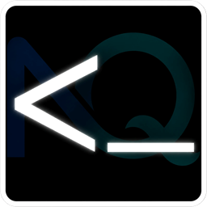
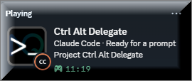
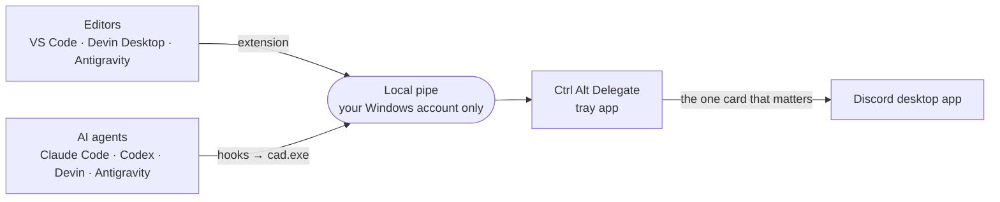

# Ctrl Alt Delegate

**One Developer. Multiple Agents. One Workflow.**

A [NovusQuest Studio](https://github.com/NovusQuestStudio) project

Discord presence for most of your coding tools. Your editors and AI agents share one Discord card
that always shows what matters right now.

[**Download**](../../releases/latest) · [Quick start](#quick-start) · [Privacy](#privacy) · [FAQ](#faq)

## What it does

You might have VS Code open, Claude Code working in a terminal and Codex waiting on a question, all
at once. Each tool on its own would fight over your Discord status. Ctrl Alt Delegate keeps the only
connection to Discord and picks the one that matters:

- **The card follows you.** The window you're looking at comes first, then whatever is working,
  then whatever you prompted last. A pin overrides all of it.
- **It shows the state, not the work.** "Working", "Waiting for input", "Ready for a prompt",
  "Editing". Never your prompts, code or file names.
- **It's set up in one click.** A setup window finds your tools and connects them. No config files,
  no terminal.
- **It stays out of the way.** A small tray app (about 14 MB of memory) that starts with Windows if
  you want it to.

## Supported tools

| Tool | Editor | AI agent |
|---|:---:|:---:|
| **VS Code** and **VS Code Insiders** | ✅ | |
| **Claude Code** (CLI and desktop app) | | ✅ |
| **Codex** (desktop app; CLI expected to work) | | ✅ |
| **Devin** (Devin Desktop; CLI expected to work) | ✅ | ✅ |
| **Antigravity** (IDE and CLI) | ✅ | ✅ ¹ |

¹ Antigravity has no "waiting for permission" signal, so its card shows **Working** and **Ready**
only.

Windows 11 first; macOS is planned. Devin's cloud sessions are under investigation.

## Quick start

1. **Download** `CtrlAltDelegate-<version>-windows-x64.zip` from [Releases](../../releases/latest)
   and unzip it somewhere you'll keep, such as `%LOCALAPPDATA%\Programs`. It creates a `CtrlAltDelegate`
   folder; to upgrade later, unzip the new version over it.
2. **Run** `ctrl-alt-delegate.exe`. Windows may say the publisher is unknown, because the app isn't
   code-signed yet: choose **More info → Run anyway**.
3. **Tick your tools** in the **Connect your tools** window that opens, and click **Apply**.
4. **Restart or reload** the tools you connected. For Codex, also approve its hooks under
   **Settings → Hooks**; the window shows "Hooks approved" when that's done.

Reopen the window any time from **Connect/Disconnect Tools** in the tray menu. Untick a tool to disconnect
it. **Show commands** lists exactly what **Apply** will run, so you can check it, or copy the commands
and run them yourself. Prefer the terminal? See [Manual setup](docs/manual-setup.md).

To check the download first, compare `Get-FileHash -Algorithm SHA256 <zip>` in PowerShell with
`SHA256SUMS.txt` from the same release.

## How it works

Each editor and agent reports a state change ("working", "waiting", "idle") to the tray app on your
PC. The tray app picks one session and updates your Discord card. Nothing leaves your computer except
that card, which goes to the Discord app you already run.

## Privacy

- **No telemetry, no accounts, no paid APIs.** The only connection is to the Discord app on your PC.
- **Prompts, code, tool details, transcripts and file names are never read or sent.** Agents report
  only their state.
- **Your project name is hidden** unless you turn on **Show project name**.
- **Only your Windows account can talk to the app.** It listens on a local named pipe, not a network
  port.
- **Your settings stay yours.** Connecting a tool adds Ctrl Alt Delegate's own plugin, and nothing
  else in that tool's settings or hooks changes.

## FAQ

**Windows says "unknown publisher". Is it safe?**
The app isn't code-signed yet, so Windows can't show a publisher. Each release includes
`SHA256SUMS.txt` to check your download against, and the source for every release is in this
repository.

**Which session does the card show?**
The one in the window you're looking at, then one that's working, then the one you prompted last.
Pin a session from the tray menu to keep it on the card. Details are in the
[reference](docs/reference.md#how-the-card-is-chosen).

**Can I hide my activity for a while?**
Yes: **Pause** in the tray menu, or turn off **Share activity on Discord**.

**I already use another Discord presence extension.**
Turn it off, for example `discord-vscode`, so the two don't take turns overwriting your status.

**Does it work on macOS or Linux?**
Not yet. Windows 11 comes first, and macOS is planned.

## More

- [Manual setup](docs/manual-setup.md): every command the setup window runs, per tool
- [Reference](docs/reference.md): tray menu, settings, command line, building from source,
  troubleshooting
- For maintainers: [publishing to winget](docs/winget.md), [code signing](docs/code-signing.md)
- [Changelog](CHANGELOG.md) · [Security](SECURITY.md)

## License

MIT © 2026 NovusQuest Studio. Originally based on
[agent-discord-presence](https://github.com/LitoMore/agent-discord-presence) by LitoMore; see
[NOTICE.md](NOTICE.md).

*Because sometimes the smartest move is knowing when to delegate.*

Made by [NovusQuest Studio](https://github.com/NovusQuestStudio)

