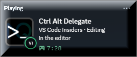
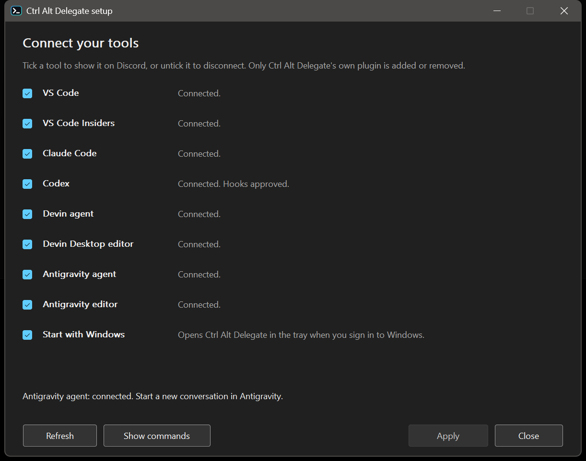
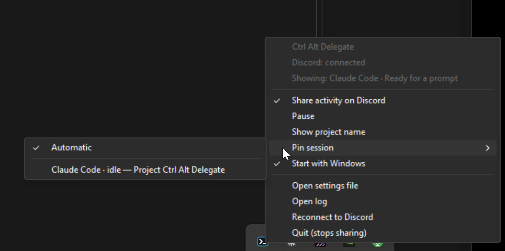

# Ctrl Alt Delegate

**One Developer. Multiple Agents. One Workflow.**

Discord presence for most of your coding tools. A small Windows tray app
keeps the only connection to Discord. Your editor and agents report what state they're in (working,
waiting, idle), and the app shows the one that matters most right now.

<p>
  
  
</p>

## Supported tools

| Tool | Status |
|---|---|
| VS Code (Stable) | ✅ Supported (extension) |
| VS Code Insiders | ✅ Supported (extension) |
| Claude Code (CLI and desktop app) | ✅ Supported (plugin hooks) |
| Codex Desktop | ✅ Supported (plugin hooks) |
| Codex CLI | ✅ Expected to work (same plugin and hook engine; not separately tested) |
| Devin Desktop agent sidebar | ✅ Supported (hooks in Devin's config) |
| Devin Desktop editor | ✅ Supported (extension) |
| Devin CLI | ✅ Expected to work (same hooks and config as the sidebar; not separately tested) |
| Antigravity agent (IDE and CLI) | ✅ Supported (plugin hooks). Shows Working and Ready; Antigravity has no waiting signal |
| Antigravity editor | ✅ Supported (extension) |
| Gemini CLI | ❌ Not planned: Google replaced it with Antigravity CLI for free accounts |
| Devin (cloud) | 🔬 Under investigation |

Windows 11 first. macOS is planned.

## Privacy

- No telemetry. The only connection is to the Discord desktop app on your PC; nothing goes to the internet.
- Prompts, code, tool arguments, transcripts, and file names are never read or sent.
- The project folder name is hidden unless you turn on **Show project name**.
- No AI-generated summaries, no paid APIs, no Discord bot token or client secret.
- Agents talk to the app over a local named pipe that only your Windows account can open.

## How the card is chosen

Priority goes like this:

1. A pinned session always wins.
2. Next, a session running in the window you're looking at.
3. Then a session that's working beats an idle one.
4. Then the session you prompted most recently.

A background agent finishing its work doesn't take the card from the one you're using. Changes you
didn't trigger wait 5 seconds before the card switches, so it doesn't flicker. Sessions clear as soon
as their program exits, and timers survive restarts of the app.

## Install from a release

1. Download `CtrlAltDelegate-<version>-windows-x64.zip` and `SHA256SUMS.txt` from the Releases page.
2. Check the download in PowerShell: `Get-FileHash -Algorithm SHA256 <zip>` must match `SHA256SUMS.txt`.
3. Unzip it to a permanent folder, for example `%LOCALAPPDATA%\Programs\CtrlAltDelegate`.
4. Run `ctrl-alt-delegate.exe`.
   - Windows may warn about an unknown publisher, because the files aren't code-signed yet. Choose
     **More info → Run anyway**.
   - If you move the folder later, turn **Start with Windows** off and on again.
5. The **Connect your tools** window opens. It finds VS Code, VS Code Insiders, Claude Code,
   Codex, Devin and Antigravity on your PC and shows whether each one is connected. Tick the ones you want and click
   **Apply**. Untick one later to disconnect it.
   - To open it again, use **Connect your tools…** in the tray menu, or run `ctrl-alt-delegate.exe`
     a second time.
   - **Codex** won't run plugin hooks until you approve them: restart Codex, open **Settings → Hooks**
     and approve Ctrl Alt Delegate. The window says "Hooks approved" once that's done.
   - Restart open Claude Code sessions, and reload open VS Code windows, after connecting them.
   - **Devin:** start a new chat in the agent sidebar after connecting, and reload Devin Desktop's
     windows for the editor. Devin doesn't run hooks in a folder opened in Restricted Mode.
   - **Antigravity:** close it completely before connecting or disconnecting its agent, because it
     locks its plugin folder while it runs. Then start a new conversation.
   - If you move the folder later, open the window and click **Apply** to relink the plugins.



The window runs each tool's own installer (`code --install-extension`, `claude plugin`,
`codex plugin`). It adds only the Ctrl Alt Delegate plugin and doesn't change any other settings or hooks.
Devin has no installer for hooks, so `cad.exe devin connect` adds ours to the `"hooks"` section of
Devin's settings file, `%APPDATA%\devin\config.json`. Everything else in that file is kept, and the
first change saves the original next to it as `config.json.cad-backup`. Its sections may come back in
a different order, which doesn't change their meaning.
Click **Show commands** to see exactly what **Apply** will run, with the real paths on your PC, and
**Copy** them to run yourself in PowerShell instead. Each command is also written to the log as it
runs. The general commands are under **Manual setup** below.

## Build and run (from source)

Requires the Rust toolchain (and Node.js only to build the VS Code extension).

```bash
cargo build --release --manifest-path apps/tray/Cargo.toml
```

Start `apps/tray/target/release/ctrl-alt-delegate.exe`. A tray icon appears. Right-click it to see
status, share or stop sharing, pause, show the project name, pin a session, start with Windows, open
the log or settings, reconnect, or quit.



Run `scripts/build.ps1 -Extension` first. It builds the app, copies `cad.exe` into both agent
plugins, and packages the VS Code extension. Then use **Connect your tools…** in the tray menu, or
the manual commands below.

## Manual setup

Use the unzipped release folder (or the repository root) wherever the commands say
`<path to this folder>`.

**VS Code** (use `code-insiders` for Insiders):

```bash
code --install-extension "<path to this folder>\ctrl-alt-delegate-vscode.vsix"
```

**Claude Code:**

```bash
claude plugin marketplace add "<path to this folder>"
claude plugin install ctrl-alt-delegate@ctrl-alt-delegate
```

**Codex (desktop app or CLI):** Codex Desktop includes a `codex.exe` command-line tool. In PowerShell,
with Codex open:

```powershell
$codex = (Get-Process codex | Select-Object -First 1).Path
& $codex plugin marketplace add "<path to this folder>"
& $codex plugin add ctrl-alt-delegate@ctrl-alt-delegate
```

Restart Codex. Then approve the plugin's hooks under **Settings → Hooks**: Codex doesn't run plugin hooks until you trust them.

**Devin:** for the agent sidebar and the Devin CLI, run this from the unzipped folder, then start a
new chat in Devin. Use `disconnect` to remove the hooks again.

```powershell
& "<path to this folder>\cad.exe" devin connect
```

**Antigravity:** with Antigravity closed, run
`agy plugin install "<path to this folder>\plugins\antigravity"` (remove it with
`agy plugin uninstall ctrl-alt-delegate`). For its editor, use
`antigravity-ide --install-extension "<path to this folder>\ctrl-alt-delegate-vscode.vsix"`.

For Devin Desktop's editor, install the extension with
`devin-desktop --install-extension "<path to this folder>\ctrl-alt-delegate-vscode.vsix"`.

None of these installs change your existing hooks. To remove the plugins, run
`claude plugin uninstall ctrl-alt-delegate@ctrl-alt-delegate` or
`codex plugin remove ctrl-alt-delegate@ctrl-alt-delegate` (or untick them in **Connect your tools**).

## Command line

`cad.exe status | pause | resume | pin AGENT:ID | unpin | start | stop | devin connect | devin disconnect | paths`

## Settings

Settings live in `%APPDATA%\CtrlAltDelegate\config.json`. Open the file from the tray menu; changes
apply within a second.

```json
{ "enabled": true, "showProject": false, "largeImage": "ctrl_alt_delegate_icon", "staleMinutes": 30 }
```

`largeImage` is the Ctrl Alt Delegate icon by default. To hide the image, set it to `""`.

## Troubleshooting

- **Nothing shows in Discord:** make sure the Discord desktop app is running. Check that the tray says
  "Discord: connected", and turn on **Settings → Activity Privacy → Share your activity** in Discord.
- **Two presences fight over your status:** turn off other Discord presence extensions and plugins
  (for example `discord-vscode`).
- **Logs:** tray → **Open log** (`%LOCALAPPDATA%\CtrlAltDelegate\ctrl-alt-delegate.log`).

## License

MIT. Originally based on agent-discord-presence by LitoMore; see [NOTICE.md](NOTICE.md).

*Because sometimes the smartest move is knowing when to delegate.*
