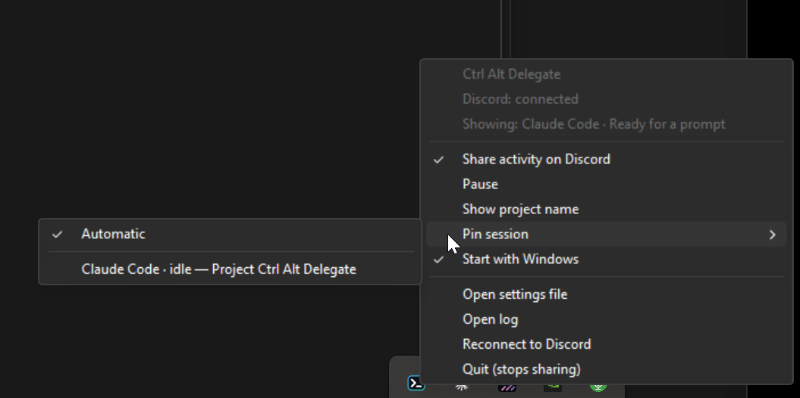

# Reference

## Tray menu

Right-click the tray icon to see what's being shown, turn sharing on or off, pause, show the project
name, pin a session, connect or disconnect tools, start with Windows, open the settings file or log, reconnect
to Discord, or quit. The menu follows Windows dark and light mode.



## How the card is chosen

1. A pinned session always wins.
2. Next, a session running in the window you're looking at.
3. Then a session that's working beats an idle one.
4. Then the session you prompted most recently.

A background agent finishing its work doesn't take the card from the one you're using. Changes you
didn't trigger wait 5 seconds before the card switches, so it doesn't flicker. Sessions clear as soon
as their program exits, and timers survive restarts of the app.

## Settings

Settings live in `%APPDATA%\CtrlAltDelegate\config.json`. Open the file from the tray menu; changes
apply within a second.

```json
{ "enabled": true, "showProject": false, "largeImage": "ctrl_alt_delegate_icon", "staleMinutes": 30 }
```

| Setting | Meaning |
|---|---|
| `enabled` | Share activity on Discord. Same as the tray's **Share activity on Discord**. |
| `showProject` | Show the project folder's name on the card. Off by default. |
| `largeImage` | The card's image. Set it to `""` to hide the image. |
| `staleMinutes` | Clear an agent session after this many minutes with no activity. |

## Command line

`cad.exe` sits next to the app. Agents and editors use it to report activity; you can use it too.

| Command | What it does |
|---|---|
| `cad status` | Connection, sessions and the current activity, as JSON |
| `cad pause` / `cad resume` | Hide or restore your Discord activity |
| `cad pin AGENT:SESSION_ID` / `cad unpin` | Always show one session, or go back to automatic |
| `cad start` / `cad stop` | Start the tray app, or quit it and clear your activity |
| `cad devin connect` / `cad devin disconnect` | Add or remove the Devin hooks |
| `cad paths` | Where the settings, sessions, log and pipe are |

## Build from source

Requires the Rust toolchain, and Node.js only for the VS Code extension.

```powershell
.\scripts\build.ps1 -Extension
```

This builds the app, copies `cad.exe` into each agent plugin, and packages the extension. Then start
`apps\tray\target\release\ctrl-alt-delegate.exe` and use **Connect/Disconnect Tools** in the tray menu.
`.\scripts\package.ps1` makes the release zip and its checksum file.

Run the tests with `cargo test` in `apps\tray` and `npm test` in `apps\vscode`.

## Troubleshooting

- **Nothing shows in Discord:** make sure the Discord desktop app is running and the tray says
  "Discord: connected". In Discord, turn on **Settings → Activity Privacy → Share your activity**.
- **Two presences fight over your status:** turn off other Discord presence extensions and plugins,
  for example `discord-vscode`.
- **Codex never shows up:** approve its hooks in Codex under **Settings → Hooks**. The setup window
  says "Hooks approved" once that's done.
- **Antigravity won't connect or disconnect:** close Antigravity completely and click **Apply** again.
- **You moved the app folder:** open **Connect your tools**, click **Apply** to relink the plugins,
  and turn **Start with Windows** off and on again.
- **Logs:** tray → **Open log** (`%LOCALAPPDATA%\CtrlAltDelegate\ctrl-alt-delegate.log`). Every
  command the setup window runs is recorded there.
